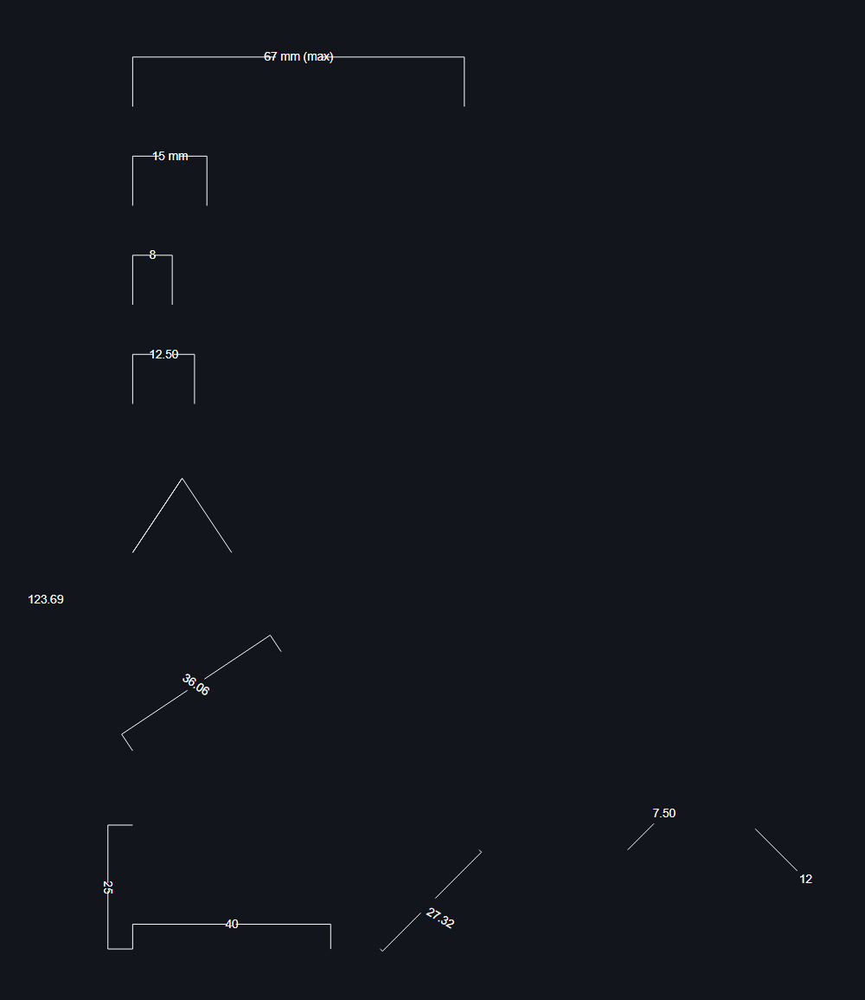

# CAD Viewer（iOS）

開 DWG / DXF / PDF 的 iOS App。DXF 用原生繪製，DWG 交給內嵌的 LibreDWG wasm，
PDF 用系統的 PDFKit。

 

## 三種檔案，三條路

| 副檔名 | 引擎 | 理由 |
|---|---|---|
| `.dxf` | SwiftDXF + SwiftUI `Canvas` | 純 Swift、MIT、零依賴；手勢、縮放全部原生 |
| `.dwg` | `WKWebView` + LibreDWG wasm | DWG 沒有可用的開源原生解析器 |
| `.pdf` | `PDFKit` | 系統內建，翻頁、縮放、選字、連結都已經做好 |

DXF 與 DWG 的分工不是猜的，是實測四張真實圖紙（三個 DWG 版本 + 一個 DXF）後的結論，
詳見 [`verification/`](verification/)。

## 目錄

```
ios/
├── DXFGeometry/     幾何核心：攤平、取景、座標變換（純 Swift，可測）
├── CADViewer/       SwiftUI + WebKit 應用層
├── web/             DWG 網頁檢視器（Vite，產物放進 App bundle）
├── project.yml      XcodeGen 設定
└── README.md        詳細說明
verification/        驗證腳本與結論
samples/             LibreDWG 的測試圖紙
shots/               各方案的實際截圖
```

## 建置

```bash
cd ios
./web/build-for-ios.sh          # DWG 檢視器產物 → App bundle
brew install xcodegen
xcodegen generate
open CADViewer.xcodeproj
```

## 三個容易踩的坑

**DWG 不能用 `file://`。** `fetch`、Web Worker、`WebAssembly.instantiateStreaming` 在上面
全被限制，wasm 載不起來。做法是用 `WKURLSchemeHandler` 開一個 `cadviewer://`，
MIME 給對（`application/wasm`、`text/javascript`），wasm 才能串流編譯。

**DWG 位元組別塞進 URL。** 幾 MB 的 base64 會爆掉。頁面去 `./__dwg__` 抓，原生那邊回。

**PDF 不要自己畫。** `PDFKit` 已經是系統的 PDF 引擎，重寫只會更慢、更差，
而且會漏掉選取、連結、搜尋這些使用者預期的行為。

## 已驗證 / 未驗證

實測通過（不需要 Mac）：

- 幾何核心與檔案路由 **187 項檢查**：圖元攤平、ACI 色票、取景、縮放與平移算式、
  副檔名路由、錯誤訊息、bundle 路徑逃逸（4 種）、MIME type
- `example_2018.dwg` → DXF：158 個實體全部轉成幾何，零 NaN，層名與文字正確
- DWG 網頁端在 WebKit（Safari 引擎）iPhone 尺寸下開圖成功，零 console 錯誤

還需要 macOS 才能確認：

- SwiftUI 層編譯（含 `PDFViewer`、`DWGViewer`）
- `WKURLSchemeHandler` 在真機的載入
- 手勢手感

**為什麼不是 Linux CI 全包**：SwiftDXF 在 Linux 上編譯不過 —— 它的 `CodePage` 用
CoreFoundation 的 `CFStringEncoding` 解碼，guard 寫的是 `canImport(CoreFoundation)`，
在 Linux 上成立但符號不存在。上游自己也只在 macOS 測試。所以那 187 項檢查只能在
Mac 上跑；CI 只做不需要 Swift 的部分（佈局檢查、DWG 網頁端建置）。

## 授權

本 repo 是 MIT（見 [LICENSE](LICENSE)）。相依元件各自獨立：

| 元件 | 授權 | 能不能商用 |
|---|---|---|
| SwiftDXF | MIT | 可以 |
| mlightcad（`@mlightcad/*`） | MIT | 可以 |
| PDFKit | Apple 系統框架 | 可以 |
| **LibreDWG**（DWG 用的 wasm） | **GPL-3.0** | **不可**用在閉源 App |

也就是說 **DXF 與 PDF 兩條路徑可以直接商用，只有 DWG 卡在 GPL**。
要閉源上架 DWG，唯一正路是接 ODA Drawings SDK —— 那時只需換掉 `DWGViewer` 的實作，
`DrawingKind` 的路由與其他程式都不用動。
