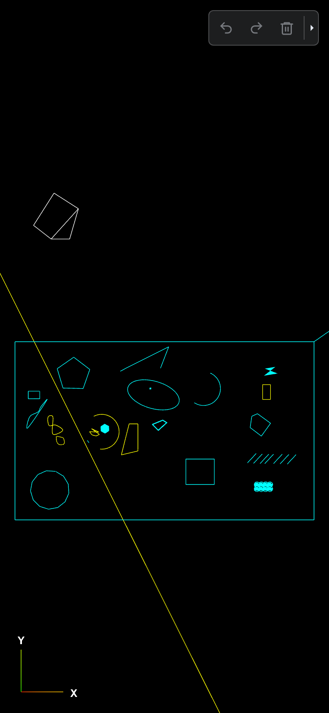

# CAD Viewer（iOS）

開 DWG / DXF / PDF 的 iOS App。DXF 用原生繪製，DWG 交給內嵌的 LibreDWG wasm，
PDF 用系統的 PDFKit。

 

## 三種檔案，三條路

| 副檔名 | 引擎 | 理由 |
|---|---|---|
| `.dxf` | SwiftDXF + SwiftUI `Canvas` | 純 Swift、MIT、零依賴；手勢、縮放全部原生 |
| `.dwg` | `WKWebView` + LibreDWG wasm | DWG 沒有可用的開源原生解析器 |
| `.pdf` | `PDFKit` | 系統內建，翻頁、縮放、選字、連結都已經做好 |

DXF 與 DWG 的分工不是猜的，是實測四張真實圖紙（三個 DWG 版本 + 一個 DXF）後的結論，
詳見 [`verification/`](verification/)。

## 目錄

```
ios/
├── DXFGeometry/     幾何核心：攤平、取景、座標變換（純 Swift，可測）
├── CADViewer/       SwiftUI + WebKit 應用層
├── web/             DWG 網頁檢視器（Vite，產物放進 App bundle）
├── project.yml      XcodeGen 設定
└── README.md        詳細說明
verification/        驗證腳本與結論
samples/             LibreDWG 的測試圖紙
shots/               各方案的實際截圖
```

## 建置

```bash
cd ios
./web/build-for-ios.sh          # DWG 檢視器產物 → App bundle
brew install xcodegen
xcodegen generate
open CADViewer.xcodeproj
```

## 四個容易踩的坑

**DWG 不能用 `file://`。** `fetch`、Web Worker、`WebAssembly.instantiateStreaming` 在上面
全被限制，wasm 載不起來。做法是用 `WKURLSchemeHandler` 開一個 `cadviewer://`，
MIME 給對（`application/wasm`、`text/javascript`），wasm 才能串流編譯。

**DWG 位元組別塞進 URL。** 幾 MB 的 base64 會爆掉。頁面去 `./__dwg__` 抓，原生那邊回。

**PDF 不要自己畫。** `PDFKit` 已經是系統的 PDF 引擎，重寫只會更慢、更差，
而且會漏掉選取、連結、搜尋這些使用者預期的行為。

**`@State` 的初始值只生效一次。** 開完一張圖再開第二張，view 裡 `@State` 的 transform 會保留舊值——
新的圖會用上一張的縮放位置。修法是用 `.id(drawing.name)` 強制重建，再加一層
`onChange` 保險。同一個坑也出現在載入競態：慢的解析完成時會覆蓋後來選的檔案，
所以載入帶著世代編號。

## 已驗證 / 未驗證

**每次 push 都在 CI 上跑**（7 個 job，全綠）：

- `swift test`：幾何、路由、取景、批次、錯誤訊息、actor 隔離等套件（項數以輸出為準）
- harness：覆蓋圖元攤平、ACI 色票、取景、縮放/平移、路由、bundle 路徑逃逸、MIME、
  批次繪製、尺寸文字、hatch 實心與圖案、區塊屬性（項數以 harness 自己的輸出為準）
- 座標與檔案交叉驗證，用與 Swift 端零共用的讀取器
- DWG 網頁端在真實瀏覽器中載入與重開；三個 DWG 格式各開一次，外加回全圖
- 真實圖紙切成十段，每一段不是畫出來就是被回報
- 佈局、workflow 結構、API 參數標籤、主執行緒 I/O、retain cycle、actor 隔離
- 每個檢查都曾在它對應的缺陷重新出現時報錯（`check-the-checks.mjs`：複製一棵樹、改壞一處、要求非零退出）
- `project.yml` 與 `Info.plist`：路徑不存在、target 宣告兩次、開檔需要的 key
- 授權：每個依赖與每個打進 bundle 的資產都有對應聲明

型別檢查是靠 `verification/stubs/` 的**平台 stub**：把 app 用到的 SwiftUI / WebKit /
PDFKit 介面宣告出來，就可以用真正的 `swiftc -typecheck` 檢查 app 自己的檔案。它抓到過
5 個只靠 `-parse` 看不到的真缺陷，細節見 [verification/stubs/README.md](verification/stubs/README.md)。

**仍然未驗證**：

- 手勢手感、真機上的 scheme handler、以及 UI 實際長什麼樣
- stub 的 `body` 從不執行，所以型別檢查證明能編譯，不證明畫面正確
- 沒有 macOS runner：repo 已公開、Actions 已啟用，`macos-14` 的 job 仍在一秒內被取消
  且沒有指派 runner。我用一個探測 workflow 直接確認過。

**引擎的限制，不是這個 app 能修的**：

- **被截斷的 DWG 會畫出部分內容而不報錯**。把 `example_2018.dwg` 切成 10%–95%，
  六個切口全部都回報 `rendered`。LibreDWG 接受它能解析的部分，不給筆數也不給警告，
  所以 app 無法分辨一張完整的圖和一張殘缺的圖。DXF 有 `skipped` 計數，DWG 沒有。
  DWG 的詳細面板把這件事寫給使用者看，而不是假装圖是完整的。
  （`verification/test-dwg-damaged.mjs` 跑這六個切口，並在不是每個切口都得到結果時失敗。）

所以「能不能在真機上跑起來」沒人驗過。凡是不需要 Apple SDK 能驗的，都驗了；
剩下的寫在這裡，沒有假裝覆蓋。

## 授權

本 repo 是 MIT（見 [LICENSE](LICENSE)）。相依元件各自獨立，完整的授權與版本見
[THIRD-PARTY-NOTICES.md](THIRD-PARTY-NOTICES.md)：

| 元件 | 授權 | 能不能商用 |
|---|---|---|
| SwiftDXF | MIT | 可以 |
| mlightcad（`@mlightcad/*`） | MIT | 可以 |
| PDFKit | Apple 系統框架 | 可以 |
| **LibreDWG**（DWG 用的 wasm） | **GPL-3.0** | **不可**用在閉源 App |

也就是說 **DXF 與 PDF 兩條路徑可以直接商用，只有 DWG 卡在 GPL**。
要閉源上架 DWG，唯一正路是接 ODA Drawings SDK —— 那時只需換掉 `DWGViewer` 的實作，
`DrawingKind` 的路由與其他程式都不用動。
